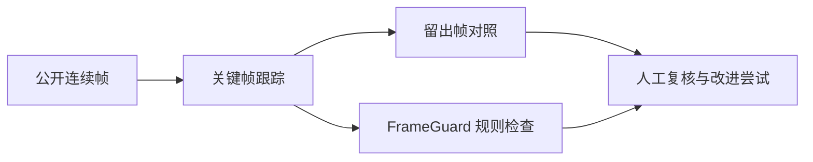

# 长序列标注质量评测

用公开无人机视频分析自动跟踪框的边界问题，并检查 FrameGuard 规则质检的覆盖范围。项目关注**测试设计、人工复核与问题分析**；实验不代表生产准确率。


*图像：USC MCL Drone Dataset，© 2019 University of Southern California；为裁剪叠框衍生图，[来源及许可](tracking-case/THIRD_PARTY_LICENSES.md)。仓库不含公司图片、视频、标注或私有配置。*

## 问题和方法

长序列用少量关键帧生成中间帧时，边界可能漏包或过宽。规则可以检查越界等错误，但不能保证框贴合目标。评测应把**自动结果**和**质检覆盖**分开看。



- **数据**：USC MCL 公开数据的两段视频，每段取 61 张连续帧；数据集每 15 帧提供一个参考框。
- **跟踪对照**：首段分别使用 2 个和 3 个关键帧，第 16、46 帧留出检查；第二段用于检查候选规则。
- **质量检查**：将跟踪结果输入 FrameGuard，区分规则无告警与边界已经确认准确。
- **人工复核**：项目使用者对首段 3 张公开叠框图反馈了左侧漏包或上方过宽；其余复核项仍待判断。

## 发现与改进结果

| 观察 | 结果及解释 |
|---|---|
| 两个留出帧的跟踪结果 | 两关键帧 IoU 为 **0.7528 / 0.7729**；三关键帧为 **0.7564 / 0.7812**。只说明这两个帧与数据集参考框的几何重合程度。 |
| FrameGuard 规则 | 两组首段跟踪结果各 61 帧均无告警；规则不验证目标边界贴合，**无告警不等于标注准确**。 |
| 高度收缩候选规则 | 首段三关键帧设置提示 **53/58** 个可检查帧；固定规则后在第二段提示 **52/58**。提示过多，暂不建议作为默认规则。 |
| 单边候选 | 针对反馈分别尝试左边扩展和上边收缩。使用者在第三帧两个上边候选中认为一个相对更合适；前两帧新候选尚未逐张确认。第二段压力检查未支持自动推广。 |

IoU 是框交集面积除以并集面积；**53/58 等是提示比例，不是误报率或召回率**。参考框未经过本项目独立双人复核，也没有完整逐帧真值。第三帧候选按单人反馈选出，不能代表其他场景。

## 查看证据

- [真实跟踪实验：设置、结果和局限](tracking-case/TRACKING_EXPERIMENT.md)
- [6 帧复核表、候选规则和不利结果](tracking-case/REVIEW_AND_EXPERIMENT.md)
- [单边候选及使用者反馈](tracking-case/EDGE_REFINEMENT_REPORT.md)
- [第二段公开序列检查](tracking-case/SECOND_SEQUENCE_REPORT.md)
- [FrameGuard：规则检查与覆盖边界](frameguard-case/PUBLIC_SAMPLE_REPORT.md)

## 本地运行与复现边界

Python 3.10+，仅用标准库。以下命令从公开数据包按需获取一个参考文件，验证哈希，并复现**独立线性插值计算**：

```bash
cd tracking-case
python fetch_public_reference.py
python public_study.py --annotation local/usc_groundtruth_rect.txt --out reports/public_comparison.csv
python -m unittest discover -s tests -v
```

文件写入被忽略的 `local/`，不会下载原图；远端不支持 HTTP Range 或数据版本变化时会停止。另可在 `frameguard-case/` 运行 `python -m unittest discover -s tests -v`。

**仓库不包含定制跟踪工作器、SAM 权重或原 FrameGuard 引擎，不能仅凭仓库复跑完整真实跟踪实验。** 实验使用本机定制版工作器，不代表 X-AnyLabeling 官方原版，也没有 GUI 端到端验收。两段来自同一数据集，不能推断真实业务效果、整体准确率或人工耗时节省。

## 分工与许可

使用者提出评测与保密要求，复核了 3 张公开样本并反馈边界问题；Codex 协助代码实现、实验运行、结果整理和文档。详细贡献应按实际情况说明，不应把 AI 辅助代码表述成全部独立研发。

自写代码和文档采用 [MIT](LICENSE)；USC 图像及衍生图遵循 [USC 数据许可](tracking-case/THIRD_PARTY_LICENSES.md)，不由本仓库重新授权。上游软件、原项目和模型未随仓库分发。[公开前检查记录](PUBLICATION_CHECKLIST.md)。
