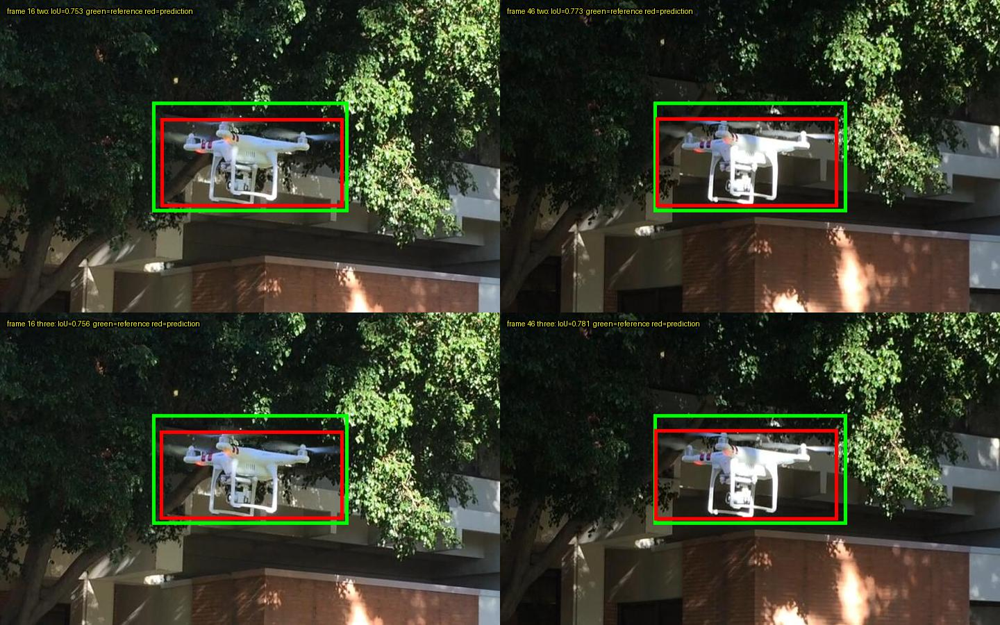
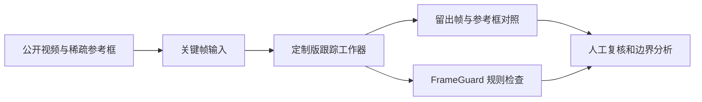

# 长序列标注质量评测

> 用公开无人机视频，评估自动跟踪的边界表现，并分析规则质检的覆盖范围。项目重点是**测试设计、问题分析与人工复核**，不是宣称模型已达到生产准确率。



*图片来自 USC MCL Drone Dataset，© 2019 University of Southern California；本图为裁剪和叠框衍生图。来源及许可见 [第三方许可](tracking-case/THIRD_PARTY_LICENSES.md)。本仓库不含公司图片、视频、标注、截图或私有配置。*

## 要解决什么问题？

长视频可以用少量关键帧辅助生成中间帧，但自动框可能在运动、遮挡或细小部件上产生偏差。规则质检能检查越界等明确错误，却不一定能判断框有没有完整包住目标。评测应同时回答：**生成结果怎样，质检又覆盖了什么？**



## 本次发现

使用 [USC MCL Drone Dataset](https://mcl.usc.edu/mcl-drone-dataset/) 的一个公开序列，运行本机定制版 X-AnyLabeling 跟踪工作器：61 张连续帧，比较首尾 2 个关键帧与增加中间帧后的 3 个关键帧。下表的第 16、46 帧作为留出帧，未用于提示；参考框来自数据集，并非本项目独立双人标注的完美真值。

| 留出帧 | 两关键帧 IoU | 三关键帧 IoU | 最大边界差：两 / 三关键帧 |
|---|---:|---:|---:|
| 16 | 0.7528 | 0.7564 | 23.25 / 23.00 px |
| 46 | 0.7729 | 0.7812 | 22.00 / 21.50 px |

两组各有 61 帧输出，输入关键帧保持不变。增加中间关键帧在这两个留出帧上略微提高 IoU；自动框上边界仍相对数据集参考框内缩。由于参考框自身的松紧、可见部件标准尚未独立复核，不能断言每个差异都是错误。IoU = 交集面积 / 并集面积；最大边界差 = 左右上下四条边坐标绝对差中的最大值。

将两组结果送入原 FrameGuard 规则，各 61 帧均无告警；该规则不判断框是否真正贴合目标。**无告警不能证明边界准确**，但目前也不能把这两个差异直接计为已确认漏报。另一个独立几何对照中，人为在副本注入的 1 个越界被规则提示；这不是对真实业务准确率的测量。

一个有用的反例：独立线性插值基线在两个相同留出帧上，增加中间关键帧后的 IoU 从 0.6821 / 0.6114 降到 0.6116 / 0.5800。线性插值不是定制跟踪器，不能把两者混为同一种算法；它说明测试设计应保留不利结果，而不是预先假定增加关键帧总有帮助。

## 可以复现什么？

需要 Python 3.10 及以上，不需要安装第三方依赖。进入对应目录后运行：

```bash
cd tracking-case
python fetch_public_reference.py
python public_study.py --annotation local/usc_groundtruth_rect.txt --out reports/public_comparison.csv
python -m unittest discover -s tests -v
```

下载脚本从官方数据包按需读取一个小型公开参考文件、校验 SHA-256，并写入被 `.gitignore` 忽略的 `tracking-case/local/`。源包是 3.95 GB，但脚本使用 HTTP Range；远端不支持、网络失败或数据版本变化时会停止。它不下载原图，不读取公司文件。

**以上命令复现的是公开参考框上的独立线性插值计算，不是实际跟踪工作器。** 定制工作器与模型权重未随仓库分发，完整跟踪实验需有权使用的相同定制环境；FrameGuard 原规则实测也需要原项目。分别在 `tracking-case/` 和 `frameguard-case/` 运行 `python -m unittest discover -s tests -v` 可测试随仓库提供的独立脚本。

## 报告与复核建议

- [定制版跟踪工作器：实验方法、结果和局限](tracking-case/TRACKING_EXPERIMENT.md)
- [FrameGuard：公开样本与规则覆盖](frameguard-case/PUBLIC_SAMPLE_REPORT.md)
- [线性插值对照与数据格式核查](tracking-case/PUBLIC_SAMPLE_REPORT.md)
- [公开数据来源和许可调查](tracking-case/PUBLIC_DATA.md)
- [公开前检查](PUBLICATION_CHECKLIST.md)

这次只看了一个序列、两个有参考框的留出帧；没有上游官方版测试、GUI 端到端验收、双人评审或真实业务工时对照。数据源网页写的是中心点坐标，但本次五张图目视核对更符合左上角坐标；这一解释只适用于当前样本，其他序列必须再核实。实际细桨是否被完整包住，不能单凭框 IoU 下结论。

下一步应选取许可清楚的多个公开序列，覆盖小目标、模糊、遮挡和出画；预先定义可见边界，双人独立复核分歧，同时记录漏包、过宽、未检查项及人工复核时间。项目使用 Codex 协助整理、实现和验证；应如实说明各自参与范围。

## 结构与许可

```text
tracking-case/    # 定制工作器报告、公开数据对照、独立插值脚本
frameguard-case/  # 原规则运行报告、独立几何演示
LICENSE           # 本仓库自写内容的 MIT 许可
```

自写代码和文档使用 MIT；X-AnyLabeling、FrameGuard 原项目及模型未随本仓库分发。USC 图像和衍生图遵循 USC 数据原始许可，不受本仓库 MIT 许可重新授权。
