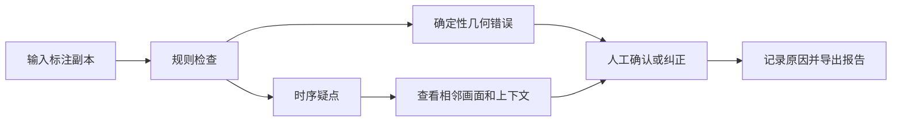

# FrameGuard：视频标注质量检查与人工复核

**作品类型：产品与评测案例 + 独立合成演示。** 针对视频序列标注，区分可以直接确定的几何错误和需要结合画面判断的时序疑点，帮助复核人员优先定位问题。

> 本公开候选目录**不包含公司图片、视频、原始标注、截图、内部地址或私有配置**。这里的 `demo.py` 是重新独立编写的教学示例，不是 FrameGuard 原版或生产版，也没有照搬现有项目源码。它只生成数字坐标，不读取任何标注素材。

## 问题与处理流程

连续多帧逐个检查标注耗时；如果把每次位移都当成错误，又可能误伤快速运动或出画。设计目标是先保证原数据安全，再让人工把注意力放到值得复核的位置。



例如：框左边界小于 0 是几何越界；相邻帧框中心变化过大只是疑点。快速运动、镜头切换、遮挡、出画、ID 关联错误都可能造成位移大，不能直接给业务打上“标错”标签。漏标目标和框是否贴合也不能靠这些规则保证发现。

## 三分钟跑示例

```bash
python demo.py
python -m unittest discover -s tests -v
```

仅需 Python 3.10+ 标准库。示例在内存中生成 10 帧矩形坐标，分别插入越界、单帧大位移、零宽框；结果写入 [reports/synthetic_findings.csv](reports/synthetic_findings.csv)。这里两条位移告警对应跳出和跳回，**不能直接当成两个独立标注错误**。实际运行检测到 4 条候选：几何越界 1、零宽 1、位移疑点 2；另有干净序列和边界等 5 项自动测试通过。这是为说明规则而构造的极小样本，不代表真实检出率。

示例仅检查同一条连续轨迹；遇到越界或无效框会中断跨帧比较。阈值为固定的 120 像素，未考虑 FPS、分辨率、相机运动或遮挡，不能用于生产结论。

## 公开无人机样本验证

一个公开序列中 5 帧有参考框、另 56 帧未标注：原规则输出 0 条提示，并说明了未标注导致的覆盖限制；将独立副本的一个框人为移出边界后，规则提示 1 条越界。同一序列的两组定制跟踪输出各 61 帧也都没有规则候选，而留出帧与参考框仍存在边界差异；规则不检查真实贴合程度。**这不是对真实标注正确率的证明。** [实测方法与局限](PUBLIC_SAMPLE_REPORT.md)。

## 评测思路与证据边界

确定性的几何错误可以按规则复现；时序疑点须由人工结合画面复核。正式评测应先写明事件匹配条件：相同规则类型、帧范围和目标关联，避免将跳出与返回重复算为两个真实事件。事件召回率 = 匹配到的真值事件 / 全部真值事件；事件精确率 = 匹配真值的告警 / 全部告警。没有可靠真值时只报告候选数量。

## 产品建议和验证路线

1. 几何问题直接展示坐标和边界；时序疑点展示前后帧，提供确认、误报、待定及原因。
2. 对缺 ID、未知 FPS、遮挡、画面拼接等情形显式降低判断强度或跳过，不能把“没检查”算“通过”。
3. 按授权场景准备干净与异常样本，两位评审独立标真值；按序列划分，记录分歧、漏报、每百帧告警数和复核耗时。
4. 将告警频率与影响一起排序：先处理会破坏原件或导致漏查的问题，再优化复核效率。是否节省工时须在对照实验后判断。

## 公开数据探索

见 [公开数据来源与许可](PUBLIC_DATA.md)。目前没有把公开图像或标注文件放入本目录；已用一个公开无人机序列的 5 个稀疏参考框运行原 FrameGuard 规则，见 [实测报告](PUBLIC_SAMPLE_REPORT.md)。LiBingyu 的公开遥感数据多数为语义分割，不能直接替代目标跟踪框标注；许可证和任务匹配需要逐项核验。

## 项目结构及公开条件

- `demo.py`：独立编写的合成规则演示。
- `tests/`：演示行为测试。
- `reports/`：本次合成输出。
- `PUBLIC_DATA.md`：候选来源、许可和任务匹配。

本目录自写示例代码和文档采用 MIT；不包含第三方数据和源码。发布前请确认对案例描述、项目经历和最终署名有权公开。本目录不是对原 FrameGuard 代码或第三方数据的重新授权。
