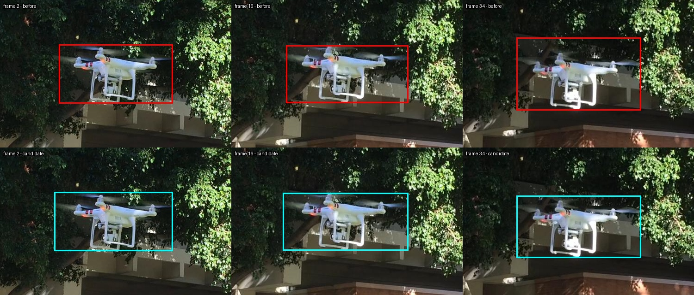
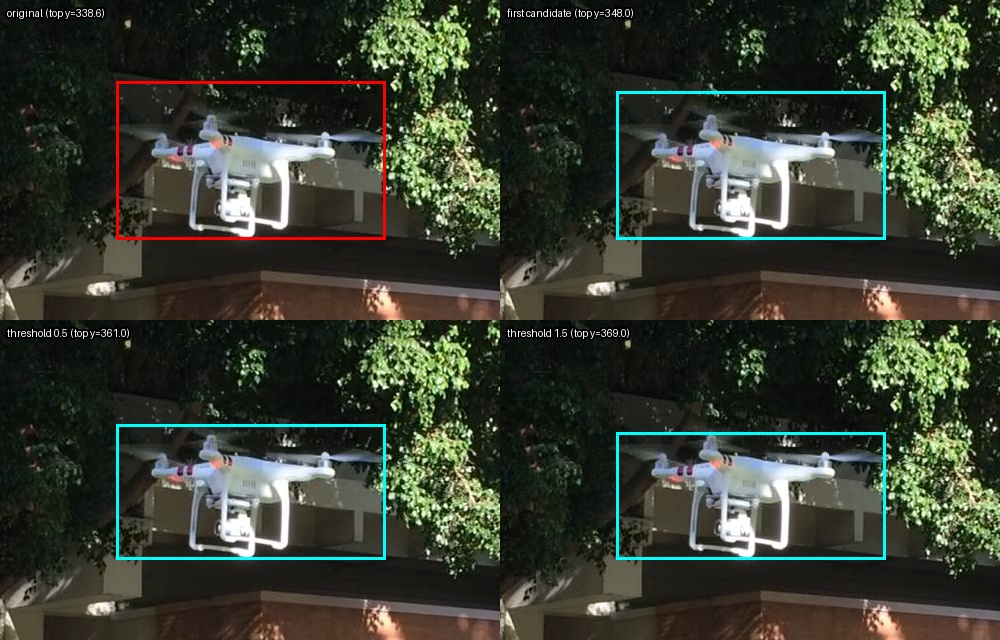

# 针对三帧的边界候选试验

## 背景和结论

用户在公开叠框图上指出：第 2、16 帧左侧没有包住，第 34 帧上方太宽。本次在 USC 公开视频的独立副本上比较实际模式与单帧候选；不更改原图、原标注、关键帧或原软件。

**结论仍是候选，不是批量修复结果。** 用户认为第 34 帧的一个候选在两个选项中相对更合适；第 2、16 帧新候选没有收到逐张确认。只测试了一段序列、三个被选中的帧，阈值和提示点针对已知案例探索，不能推断整体效果。

## 1. 原有旋翼模式的真实对照

在相同 61 张连续帧、相同 3 个关键帧、SAM 2.1 Small 和禁用缓存的设置下，对比定制工作器 `mask` 与 `rotor` 模式。两次均输出 61 帧、没有空框，旋翼模式保留关键帧；后者 31 帧带有工作器复核原因。与普通模式相比，三帧的边界坐标变化如下（左、上、右、下，单位原图 px；负数代表向左或向上）：

| 帧 | 左边 | 上边 | 右边 | 下边 |
|---|---:|---:|---:|---:|
| 2 | -10.8 | -21.1 | +4.0 | +13.7 |
| 16 | -11.4 | -28.5 | +11.4 | +6.5 |
| 34 | -8.5 | -32.6 | +5.3 | +6.3 |

它确实使左边界向外移动，但也把第 34 帧本已被用户认为偏宽的上边界继续向外扩大。边界移动不等于可见细桨已完整包住；这不能被当作已解决。不同模式执行时间受到预热和执行顺序影响，不比较性能。实验直接调用定制工作器，并非上游官方版本或 GUI 端到端测试。

## 2. 局部分割与单边候选

在同一帧的同一原始分辨率裁剪上，用工作器原框作为种子，比较 SAM 2.1 Small **单帧图像分割**：仅框、框加正点、框加正负点等。提示点由 Codex 依据公开图像试放，不是用户逐点确认的真值；模型分数没有当作准确率。该单帧试验不是视频传播结果。

- 帧 2：仅框候选左边界 801 px；加入试放正负点后为 796 px。原跟踪框为 806.8 px。
- 帧 16：仅框候选左边界 807 px；加入试放正负点后为 803 px。原跟踪框为 810 px。
- 帧 34：仅框使用 logit 阈值 0 时上边界为 348 px；采用试放正负点后为 336 px，反而更向外。对同一仅框 logits 使用 0.5 和 1.5 阈值，上边界分别为 361 和 369 px；阈值不是已校准的置信度，变严可能遗漏浅灰桨叶。

先展示的三帧单边候选中，前两帧只向左扩（分别 -10.8、-7 px），帧 34 上边只向下收 9.4 px；其余边保持原值。用户反馈**第三张仍有问题**。随后对第 34 帧展示阈值 0.5 与 1.5 的两种候选，用户认为前者（左下）相对更合适；它相对原框上边界下移 22.4 px。该偏好不等于验证绝对正确，尤其不能证明薄桨完整。第 2、16 帧候选尚未收到逐张确认。





图像来自 USC MCL Drone Dataset，© 2019 University of Southern California，图片为裁剪叠框衍生图；许可与引用见 [第三方许可](THIRD_PARTY_LICENSES.md)。

## 3. 独立、只预览的边界建议脚本

[edge_preview.py](edge_preview.py) 是独立演示，不是工作器或 FrameGuard 的修改，也不会调用 SAM。它接收外部准备的原框、候选框、用户选择的边和明确的关键帧状态；只生成 `pending_human_review` 草稿，不写回标注。默认移动不得超过原框相应宽度或高度的 10%，显式设置可到 20%；该数值只是演示上限，**不是验证过的安全阈值**。关键帧、越界或无效框、方向不符和超限均拒绝。关键帧状态由调用者提供，脚本无法自行核实其真实性。

输入示例（只是假数据）：

```json
{"width":1000,"height":1000,"items":[{"frame":1,"original":[100,100,200,200],"source":[95,100,200,200],"edge":"left_expand","is_anchor":false}]}
```

```bash
python edge_preview.py --input local/example.json --out local/new_preview.json
python -m unittest discover -s tests -v
```

输出只能创建新文件，拒绝覆盖现有文件和输入文件；输出是草稿而不是标注格式。要检查是否真正包住目标，需要人查看原图及相邻帧。也不能把此原型直接部署到真实工作流。

## 第二段公开序列的压力检查

固定用户在第一段选出的 `logit > 0.5` 方案后，在第二段两个留出帧做强制“上边收紧”实验：一帧生成 1 px 待复核候选，与数据集参考框的差异从 20 增到 21 px；另一帧因候选方向相反被护栏拒绝。第二段没有用户对这两帧的纠偏指令，**该实验是压力检查，不是合理自动批改流程**。参考框并非绝对真值，不能宣称 1 px 已确认错误，但它说明不应把第一段偏好直接套到别的帧。[查看完整记录](SECOND_SEQUENCE_REPORT.md)。

## 限制和后续

只有一名用户对少量公开叠框图给出反馈，未建立高分辨率逐像素真值，也无双人盲评。不同阈值/提示可能在其他图像上切掉细边或选中背景。建议先在多个授权公开序列中冻结候选方法，按序列拆分开发与测试，记录每条边的可见部件、漏包、过宽、不可辨认和复核时间；未验证之前不修改默认算法，不写回任何公司标注。
