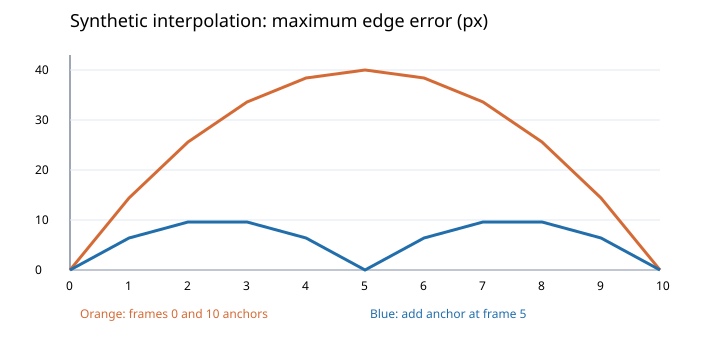
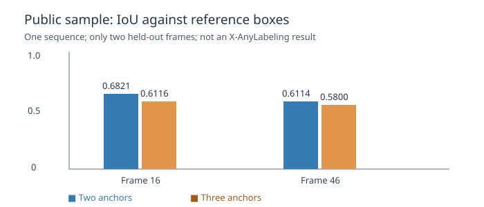

# X-AnyLabeling 长序列标注：质量分析与复核设计

长序列里，关键帧准确不意味着中间帧就准确。本案例分析自动结果的复核方式，并用一个**独立编写的合成数学实验**展示稀疏关键帧下可能出现的边界误差。

> 本目录不含公司视频、图片、标注、截图、内部配置或现有项目源码。我们用公开无人机样本分别运行了本机定制版跟踪工作器与独立线性插值基线；本案例不评测上游官方版本。

## 面向的问题

长序列标注通常要兼顾目标位置、轮廓边缘和前后帧连续性。仅看首尾关键帧，可能忽略中间运动变化；细部、遮挡、出画和镜头变化会使自动结果难以判断。人工关键帧本身也可能有误，不能不经验证就当作绝对真值。

因此应把复核拆成：

1. **关键帧保护**：记录每次修改的来源，自动生成不覆盖人工确认内容；保留预览和撤销。
2. **中间帧抽检**：按运动变化、遮挡、尺度变化和关键帧间隔筛选候选，结合前后帧核对。
3. **边界质量**：分别检查目标是否完整、框是否明显外扩、细部是否漏包；不能只看中心距离。
4. **缺少依据**：无法确认目标身份或目标已经出画时，标记不确定，不强行判错。

这些是产品和评测设计，不宣称上游项目一定存在某项缺陷，也不声称已经完成生产验证。

## 定制版工作器的公开样本实验

用 USC MCL 公开序列的 61 张连续帧，分别以首尾 2 个、首尾加中间共 3 个参考框作为关键帧，比较未用于提示的第 16、46 帧。实际运行定制版 X-AnyLabeling 的 SAM 2.1 Small 跟踪工作器：两组均有 61 帧输出，关键帧保持不变。两个留出帧中，三关键帧 IoU 为 0.7564、0.7812，两关键帧为 0.7528、0.7729；框与数据集参考边界仍有约 21.5–23.25 px 最大差异。


图像来源：© 2019 University of Southern California，USC MCL Drone Dataset；该图为裁剪和叠框衍生图，原数据许可证及引用见 [第三方许可](THIRD_PARTY_LICENSES.md)。**单个序列、两个留出帧不能代表总体效果**，参考框也不是完美真值；实际运行的是本机定制版工作器，不是上游原版或 GUI 验收。[查看完整实验与局限](TRACKING_EXPERIMENT.md)。

## 合成实验：关键帧准确，中间帧仍可能偏离



运行：

```bash
python study.py
python -m unittest discover -s tests -v
```

生成 11 帧（编号 0–10）的一维左右边界，数学上设定目标加速且宽度变化；分别用首尾两帧和额外加入第 5 帧，按边界线性插值。参考边界来自同一个**人为构造的公式**，不是人工标注或真实视频。逐帧结果见 [合成对照 CSV](reports/synthetic_comparison.csv)。

| 合成设置 | 最大边界误差均值 | 最大单帧误差 |
|---|---:|---:|
| 两个关键帧：0、10 | 24.00 px | 40.00 px |
| 三个关键帧：0、5、10 | 5.82 px | 9.60 px |

每帧误差 = 左、右边界绝对误差中的较大值；均值分母为 11 帧，包含关键帧的 0 误差。实验展示一种可能情况，**不证明实际软件采用这种插值，也不证明真实序列增加关键帧一定有效**。真实目标的二维轮廓、细桨、遮挡和运动都比该模型复杂。

## 公开无人机样本：真实参考框对照

使用 USC MCL Drone Dataset 一个公开序列的 5 个稀疏参考框，将第 16、46 帧留作检查。在这两个帧上，与首尾两关键帧相比，加入第 31 帧关键帧后，独立线性插值的 IoU 从 0.6821、0.6114 分别降到 0.6116、0.5800。**这是一个不利结果，不应被省略。** 不同于上面的合成实验，它依据真实图像的参考框，但仍只有一个序列、两帧，不代表真实产品效果。



[查看完整方法、坐标格式核查和复现步骤](PUBLIC_SAMPLE_REPORT.md)。仓库不附带未修改的原始图片或标注文件；上方展示的 USC 裁剪叠框图遵循其数据许可。

## 怎样设计一次可信的真实评测

- 先选许可允许使用的公开序列，确保任务是连续帧实例跟踪；区分公开下载、处理和再分发权限。数据源调查见 [公开数据调查](PUBLIC_DATA.md)。
- 在独立副本上定义目标类别、可见边界、遮挡/出画和缺失标注规则。不同评审先独立标注和复核争议，不能将未经核实的第一份标注当真值。
- 冻结软件版本、配置、关键帧数量和位置；在同一批序列上比较不同设置，按序列划分，保留输入输出和时间记录。
- 逐帧记录边界偏差、框覆盖及漏包细部；按目标大小、运动、遮挡和场景分层。报告中位数、分位数、样本量和不能判断的帧；不单独用框 IoU 宣称细桨完整。
- 同时记录人工核查时间、误报和撤销成功情况，检验是否真正减少工作量。优先修复会覆盖原结果和掩盖不确定性的风险。

**当前已运行本机定制版跟踪工作器和一段公开数据对照；尚无上游官方版、GUI、真实业务效果或双人评审结果。** 自动测试只验证独立脚本的计算行为。

## 来源和许可

[X-AnyLabeling 官方仓库](https://github.com/CVHub520/X-AnyLabeling)提供 AI 辅助图像/视频标注功能；其上游代码遵循项目自身 GPL 许可。本仓库未分发或修改上游代码。本项目独立编写的实验代码和文档采用 MIT；USC 图像和衍生图沿用其数据许可，不受本项目 MIT 重新授权。
