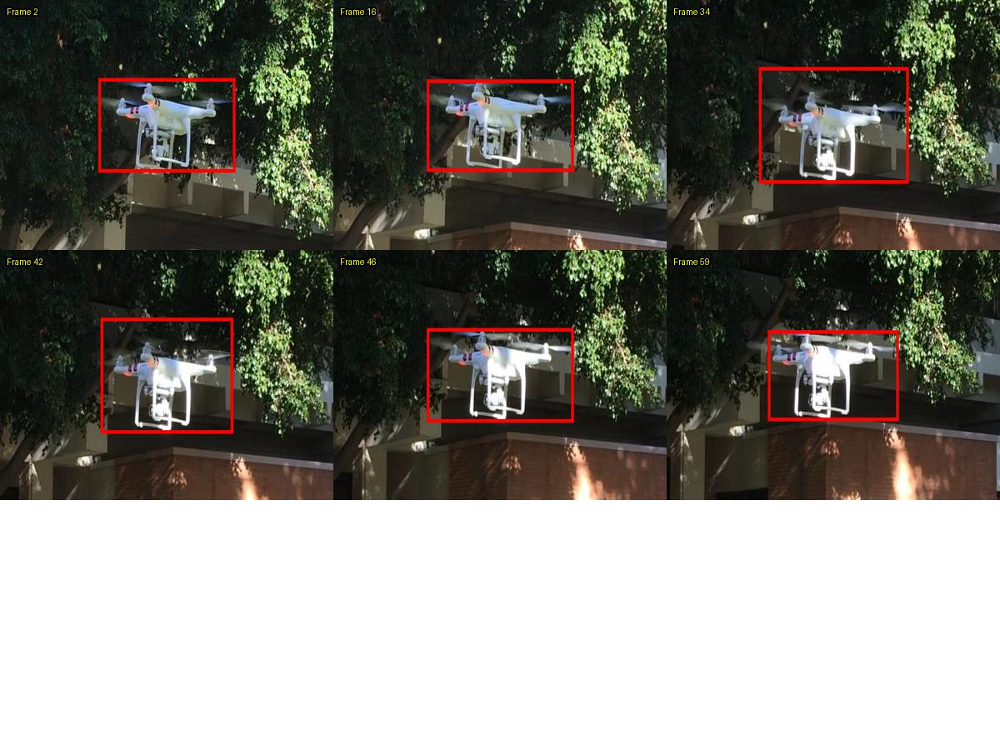

# 人工复核表与候选规则：一次未达标的改进尝试

## 问题和复核材料

对 [定制版跟踪实验](TRACKING_EXPERIMENT.md) 的 USC 公开序列，工作器输出的第 16、46 帧与数据集参考框存在边界差异；原 FrameGuard 对两组各 61 帧输出均无规则告警。FrameGuard 本就不判断目标贴合度，因此这只是覆盖缺口，**不是已经确认的漏报**。

选择三关键帧设置中的 6 帧：第 2、16、34、42、46、59 帧；其中 16 和 46 有稀疏数据集参考框，34 和 42 是候选规则未提示的对照，其余为候选提示。参考框也不是无误真值。选帧是针对同一条序列的有目的抽样，不是随机样本。



图中红框是定制工作器的输出；图像来自 USC MCL Drone Dataset，© 2019 University of Southern California。此图是裁剪和叠框衍生图，遵循原数据许可，详情见 [第三方许可](THIRD_PARTY_LICENSES.md)。**不是公司素材。**

[下载复核工作表](reports/review_worklist.csv)：记录帧号、是否存在参考框、原规则状态、候选规则状态、主体、细部、是否过宽及复核原因。表内原始观察为 **Codex 对图片的视觉初筛**。2026-10-27 用户查看上方 6 帧图后补充单人判断：帧 2、16 左侧没有包住，帧 34 上方过宽；帧 42、46、59 未作判断，仍待人工。用户没有进一步指定前两帧所漏的具体部件。这是查看公开叠框图的单人反馈，并非原图逐像素复核、完整帧真值或双人盲评。

建议评审在原始分辨率同时查看原图、红框图和相邻帧，逐项填写：主体完整 / 不完整 / 不确定；可见机臂、桨叶、脚架完整 / 部分漏包 / 不确定；是否明显过宽；结论和证据。注意帧 2、34、42、59 没有数据集参考框，不能将空缺当作真值。若图片细节本身不可辨认，应选“不确定”。不同评审先独立判断，后记录分歧；目前只有上述 3 帧的单人反馈，其他帧尚未复核。

## 候选规则与试验

**设想：**用当前帧预测框高度除以两侧关键帧高度线性插值得到的基线；比值低于 0.85 时，提示“需要复核”，不自动判为标错或改写标注。跳过关键帧、缺框、已知遮挡、画面边缘和关键帧范围之外的帧；遮挡没有信息时明确标为未知，不能当作没有遮挡。阈值 0.85 是为探索制定的示例值，**不是经过标定的产品阈值**。真实物体转向、前后移动、目标尺寸变化，以及人工框与模型框松紧习惯不同，都可能触发这个候选。

[独立原型](review_candidates.py)只输出提示、未提示或跳过及原因，不会修改 FrameGuard，也不写入或覆盖标注。实际跟踪输出未随仓库发布；脚本接受用户授权的本地 JSON 输入。`index` 使用零基帧序号，`bbox` 是 `[x1,y1,x2,y2]`，`occluded` 为 true、false 或 null：

```json
{"width":1000,"height":1000,"anchors":{"0":[100,100,200,200],"2":[100,100,200,200]},"frames":[{"index":0,"bbox":[100,100,200,200]},{"index":1,"bbox":[100,100,200,180],"occluded":null},{"index":2,"bbox":[100,100,200,200]}]}
```

将自己的输入放在被忽略的 `local/` 下，从本目录执行：

```bash
python review_candidates.py --input local/candidate_input.json --out local/candidates.csv
python -m unittest discover -s tests -v
```

## 同一公开序列的回测

对两组工作器输出运行候选规则，全部 61 帧都有框，图像尺寸 1920×1080；没有遮挡标记，故遮挡状态未知。分母为排除关键帧后**可检查的帧数**，不是异常帧数：

| 设置 | 原 FrameGuard 告警 | 可检查帧 | 候选提示 | 提示比例 | 关键帧跳过 |
|---|---:|---:|---:|---:|---:|
| 首尾两个关键帧 | 0 | 59 | 59 | 100.0% | 2 |
| 加入中间关键帧 | 0 | 58 | 53 | 91.4% | 3 |

[计数与候选连续区间](reports/candidate_coverage.csv)。原规则和候选规则检查的对象不同，不能把增加的提示数当作发现的新错误。候选规则把三个关键帧设置下的帧 16、46 都提示复核。用户认为帧 16 左侧未包住，尚未对帧 46 作判断；用户认为未提示的帧 34 上方过宽，帧 42 尚未判断。由于样本只收到三条不理想的单人反馈，且没有完整真值，**精确率、召回率、误报率和漏报率均无法计算**。

用户对三帧的反馈及规则对照如下：

| 帧（一基） | 用户对公开叠框图的单人反馈 | FrameGuard 原规则 | 高度收缩候选 |
|---|---|---|---|
| 2 | 左侧未包住，具体部件未细分 | 无提示 | 提示复核 |
| 16 | 左侧未包住，具体部件未细分 | 无提示 | 提示复核 |
| 34 | 上方过宽 | 无提示 | 未提示；该规则不检查顶部过宽 |

前两帧被提示，不代表提示原因准确定位了左侧漏包；第三帧体现了该高度收缩规则的范围缺口。此表只有用户标出不理想的三帧，没有经过独立验证的合格负例，因此不能据此计算召回率或误报率。其余三帧仍待人工判断。

候选规则对几乎所有中间帧报警，会使人工复核量显著增加，**不建议接入生产或作为默认规则**。一个合理但尚未证实的解释是：数据集关键帧框和模型输出框的松紧存在系统性差异，固定的相对高度阈值把这种差异重复报成了每一帧风险。真实尺度变化同样会产生提示；单纯加大阈值也不能证明解决问题。

本次规则想法和阈值是在已经看过该序列及其部分结果后确定，并对同一序列回测；帧 46 并非严格独立盲测集。不能声称发现了可泛化的提升。代码另用人工构造的“目标因姿态或距离而短暂变小”示例验证该情形会触发提示；这个合成对照说明潜在误报，并非测得真实数据误报率。

## 下一步

先复核剩余样本，必要时在原图确认前三帧的可见边界；再收集更多授权公开序列，按序列拆分开发与留出测试，记录不同场景的候选量和复核时间。可以尝试按连续区间聚合提示、记录遮挡和比较关键帧框的松紧，但这些都是**待验证的方案**，不宣称已改进，也不应先修改原项目。
